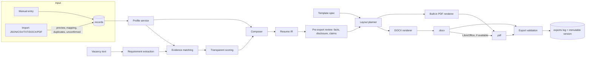

# Resume Intelligence Studio — Architecture

Version: 1.0 (matches application version 1.0.0)
Status: living document; update when a decision changes.

## 1. Environment assessment (development build)

| Item | Finding |
|---|---|
| OS | Linux x86_64 (cloud build container, no display; GUI tested with Qt `offscreen` platform) |
| Python | 3.13.x (code targets 3.11+; the brief's 3.12 is supported) |
| GUI toolkit | PySide6 6.12 (Qt Widgets + QtPdf for in-app PDF preview) |
| SQLite | 3.53 with FTS5 and JSON1 |
| DOCX | python-docx 1.2 |
| PDF | ReportLab 5.1 (built-in engine); LibreOffice 24.2 headless (DOCX→PDF, tagged PDF, ~1.5 s per document) |
| Fonts | Carlito, Caladea, Liberation Sans/Serif, DejaVu — metric-compatible with Calibri, Cambria, Arial, Times New Roman |
| Raster check tools | `pdftoppm` (used only by developer verification scripts, not by the app) |
| Network | Package index reachable; no Google or LLM credentials available — live cloud/AI calls cannot be verified here |

Primary target is macOS. Nothing in the core depends on Linux-only tools. LibreOffice is optional on every platform.

## 2. Architecture decisions (ADR summary)

| # | Decision | Rationale |
|---|---|---|
| D1 | Python package is `ris/` (the brief suggested `app/`); the other top-level folders follow the brief (`templates/`, `migrations/`, `config/`, `scripts/`, `docs/`, `sample_data/`, `tests/`). | A top-level module called `app` collides with other packages once installed or frozen; a unique name avoids import shadowing. |
| D2 | Storage uses the standard-library `sqlite3` module with explicit, versioned SQL migrations (`migrations/NNNN_name.sql`). SQLAlchemy is **not** used. | The schema is a small typed record store. An ORM would add a dependency and a mapping layer without simplifying anything; explicit SQL keeps migrations reviewable. |
| D3 | Profile facts live in one `records` table: envelope columns (id, kind, parent, order, verification, confidentiality, origin, revision, checksum, timestamps, soft-delete) plus a JSON payload validated by a Pydantic model per kind. Unknown JSON fields are preserved. | One stable, revisioned shape for every fact gives sync, backup, audit and provenance a single mechanism. Custom fields work without code changes. Forward-compatible data survives round trips through older versions. |
| D4 | Documents go **content IR → layout blocks → renderer**. The DOCX renderer (python-docx) and the built-in PDF renderer (ReportLab) consume the same layout blocks. PDF engine "Auto" prefers LibreOffice DOCX→PDF conversion when installed (identical layout to the DOCX, tagged PDF), otherwise the built-in renderer. | One source of content for both formats; a working PDF path on a Mac without LibreOffice; exact DOCX/PDF parity when LibreOffice exists. |
| D5 | Templates are versioned JSON specifications in `templates/` that select a layout system (header style, heading style, entry style, skills style, column structure, tables) plus typography and colour. User templates live in the data directory. | Templates can be created or modified without code; layout systems, not colours, make them distinct; versions are recorded in every saved resume. |
| D6 | Template fonts are limited to Calibri, Cambria, Arial and Times New Roman. The built-in PDF engine embeds bundled metric-compatible open fonts (Carlito, Caladea, Liberation) with DejaVu as a Unicode fallback. | Pagination stays consistent across Microsoft Word, LibreOffice and the built-in engine. |
| D7 | A workspace is a folder holding its own SQLite database, exports and backups. The fictional sample profile always lives in a separate, labelled workspace. | Test and demo records can never mix with the real master profile. |
| D8 | Confidentiality is enforced in layers: composition filter, pre-export disclosure review, export content scan, AI payload builder, cloud backup/sync filter, logging policy. | Defence in depth: one missed check does not leak confidential data. |
| D9 | Synchronisation is a record-level three-way merge against a `RemoteStore` interface. Implementations: local/cloud-synced folder (e.g. a Google Drive for desktop folder) and Google Drive API v3 (OAuth installed-app flow, `drive.file` scope). Conflicts preserve both versions. | The engine can be tested fully offline; least-privilege Drive access; no silent overwrites. |
| D10 | Secrets (OAuth refresh token, AI API key, cloud passphrase) live in the OS credential store via `keyring`, with a session-only in-memory fallback. Never in the database, config files or logs. | Least exposure; matches macOS Keychain behaviour. |
| D11 | The default career engine is deterministic and rules-based, and is labelled as such. An optional external LLM provider (Anthropic Messages API or any OpenAI-compatible endpoint, including local servers) can be enabled, with a minimal approved-facts payload and a preview before sending. | Works offline and free; AI is opt-in with explicit disclosure. |
| D12 | Long operations (render, convert, validate, backup, sync) run on `QThreadPool` workers; the UI thread only displays results. | Responsive UI. |
| D14 | Graphical resumes (added at the user's request, 2026-10-25) use the same IR → layout → renderer path. Charts (career timeline, publications by year) and rating bars are drawn once with Pillow at 300 dpi from recorded data and embedded as PNG in both DOCX and PDF, with alt text; every fact in a chart also appears as selectable text (legend, caption or tiles). | Identical appearance in Word, LibreOffice and the built-in engine; no information exists only inside an image; ATS-safe templates are forbidden from enabling graphics. |
| D15 | Inside two-column bodies the planner avoids nested tables (expertise as paragraphs, cards as shaded paragraphs) and clears "keep with next". | LibreOffice cannot split a page-spanning column row that contains nested tables or keep-with-next chains; verified by converting the DOCX. |
| D13 | Data directory per OS: macOS `~/Library/Application Support/Resume Intelligence Studio`, Windows `%APPDATA%\ResumeIntelligenceStudio`, Linux `$XDG_DATA_HOME/resume-intelligence-studio`. Override with `RIS_DATA_DIR`; relocation is supported in-app. | The source tree is kept separate from personal data. |

## 3. Module map

```
ris/
  app.py, __main__.py      lifecycle: arguments, logging, workspace, UI or self-test
  cli.py                   headless commands (export, backup, restore, integrity, analyse, render samples)
  paths.py, resources.py   OS data directories; bundled resource lookup (dev and frozen)
  config.py                application config (workspace registry, data dir) — no secrets
  logging_setup.py         rotating log with redaction filter
  strings.py               centralised user-facing strings
  errors.py                structured error types
  domain/                  enums, partial dates, Pydantic models per record kind, field metadata
  storage/                 database, migrations runner, record repository, settings, workspaces
  services/                profile service, completeness, chronology, duplicates, importers, JSON export
  intelligence/            text normalisation, taxonomy, vacancy extraction, evidence matching,
                           scoring, presets (Defence & Intelligence), rewriting, claims,
                           disclosure scanner, ATS checks, readiness
  composition/             content IR, resume composer, cover-letter composer, portfolio
  rendering/               template specs, layout planner, DOCX renderer, PDF renderer,
                           LibreOffice converter, fonts, plain-text export, validation, export service
  backup/                  backups, restore, integrity, encrypted archives, scheduling
  sync/                    remote stores (folder, Google Drive, in-memory), sync engine, conflicts
  security/                secret store (keyring), redaction helpers, temp-file hygiene
  ai/                      provider interface, offline rules provider, external providers, payload builder
  tracker/                 applications, deadlines
  ui/                      main window, theme, pages (18 navigation sections), widgets, workers
```

Business logic never imports `ris.ui`. The UI calls services; services call storage. This is checked by a test.

## 4. Data flow



## 5. Storage schema (summary)

See `docs/DATA_MODEL.md` for the full data dictionary and relationship diagram.

* `records`: every user-authored entity (profile facts, targets, vacancies, variants, claims, applications, cover letters).
* `records_fts`: FTS5 index for search.
* `variant_versions`: immutable resume snapshots (settings + IR + source revisions + template version).
* `exports`: export log (path, SHA-256, engine, page count, validation report).
* `settings`, `audit_log`, `sync_base`, `sync_conflicts`, `schema_migrations`.

## 6. Document engine

1. **Composer** turns the profile, variant settings, mode, template and any vacancy analysis into a `ResumeDocument` IR. Confidential records never enter the IR.
2. **Layout planner** turns the IR and template spec into renderer-neutral blocks (paragraphs with runs, right-aligned tab text, gutter text, tables, labelled sections, sidebar columns, banners, rules, spacers).
3. **DOCX renderer** maps blocks to real Word styles (`Title`, `Heading 1`, `Heading 2`, `Normal`, list numbering), tab stops, borders, shading, tables, hyperlinks, header/footer with `PAGE`/`NUMPAGES` fields and core properties.
4. **PDF renderer** maps the same blocks to ReportLab flowables with embedded TrueType fonts, per-glyph font fallback, link annotations, outline bookmarks, "Page X of Y" footers and document metadata.
5. **LibreOffice converter** (optional) converts the DOCX to a tagged PDF in an isolated profile directory with a timeout.
6. **Graphics** (`ris/rendering/graphics.py`) draws the career timeline, publications-by-year chart and five-step rating bars with the bundled fonts. Metric tiles and project cards are native tables/shaded paragraphs, so they stay selectable text.
7. **Validation** reopens both files and checks content, contacts, chronology, sections, placeholders, confidential phrases, page limits, DOCX/PDF consistency and out-of-bounds text before an export is reported as successful.

## 7. Extensibility points

* New record kind: add a Pydantic model and register it in `ris/domain/registry.py`; the generic editor and JSON export pick it up.
* New template: add a JSON spec (see `docs/TEMPLATE_GUIDE.md`).
* New layout primitive: add a block type and implement it in both renderers.
* New career preset or organisation profile: edit `config/career_presets.json`.
* New skill synonyms: edit `config/taxonomy.json`, or add them per skill in the app.
* New remote store: implement `ris.sync.remote.RemoteStore`.
* New AI provider: implement `ris.ai.provider.AIProvider`.
